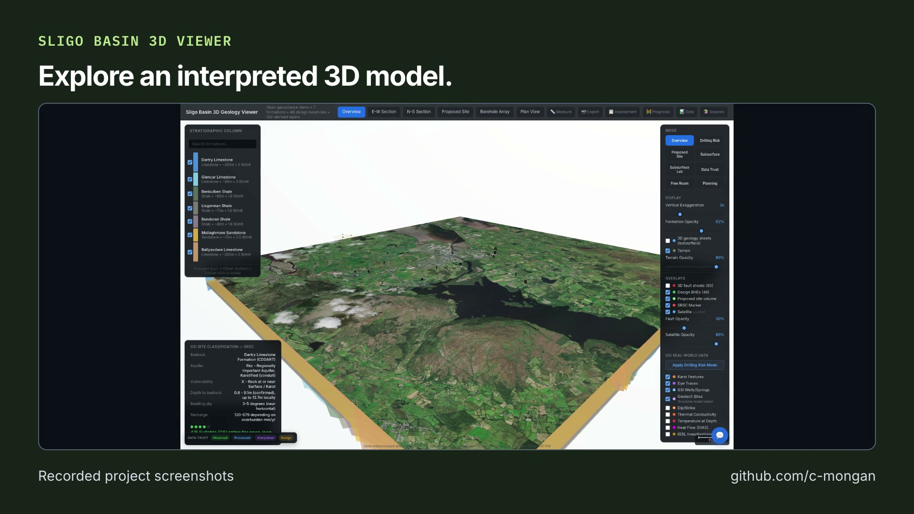

# Sligo Basin 3D Viewer: short video overview

[Open or download the MP4](https://github.com/user-attachments/assets/658acc7a-5860-48cc-8361-a632a9025a16) · [Transcript](transcript.txt) · [Captions (SRT)](captions.srt) · [Captions (VTT)](captions.vtt)

Recorded project screenshots of an interpreted geological model. Screening only; not an engineering assessment.

The video introduces the project; it does not replace its validation records or documented limits.

## Media details

- Duration: 20.633 seconds; 1920 × 1080; 30 fps; H.264 video and AAC audio.
- Published video SHA-256: `f7551ce41b4f2b52873edd9292eb5f0973e705a5f82da4d203414363cfb7a9cb`.
- AI narration: Inworld TTS 2, using the voice selected by the project author.
- Music: *Happy Beats / Business Moves Vol. 10* by [Sascha Ende, ende.app](https://ende.app/en), licensed under [CC BY 4.0](https://ende.app/en/standard-license). The track is trimmed, faded, and mixed beneath speech.
- Story and video workflow: [Brag](https://github.com/latent-spaces/brag); rendered locally with [Hyperframes](https://github.com/heygen-com/hyperframes).

## Visual sources

- [README.md](https://github.com/c-mongan/sligo-geology-viewer/blob/ba6531fbb5b375fa4006ac69bc8902ad7117d754/README.md) — source Git blob `1e5ab21d93609331d32922a09aa6ca9ca2e42622`.
- [overview.png](https://github.com/c-mongan/sligo-geology-viewer/blob/ba6531fbb5b375fa4006ac69bc8902ad7117d754/docs/assets/overview.png) — source Git blob `6472cdca5c987e196f3d7b6f91380c6ceff3bd16`.
- [cross-section.png](https://github.com/c-mongan/sligo-geology-viewer/blob/ba6531fbb5b375fa4006ac69bc8902ad7117d754/docs/assets/cross-section.png) — source Git blob `17f00fa5a9a5d022fd73b431d879592cfd57706a`.
- [data-provenance.png](https://github.com/c-mongan/sligo-geology-viewer/blob/ba6531fbb5b375fa4006ac69bc8902ad7117d754/docs/assets/data-provenance.png) — source Git blob `d34fb4adefda38f1fff472b441c2f7d28792b955`.

Contains Irish Public Sector Data (Geological Survey Ireland), licensed under CC BY 4.0. Geological surfaces and risk labels are derived interpretations.
